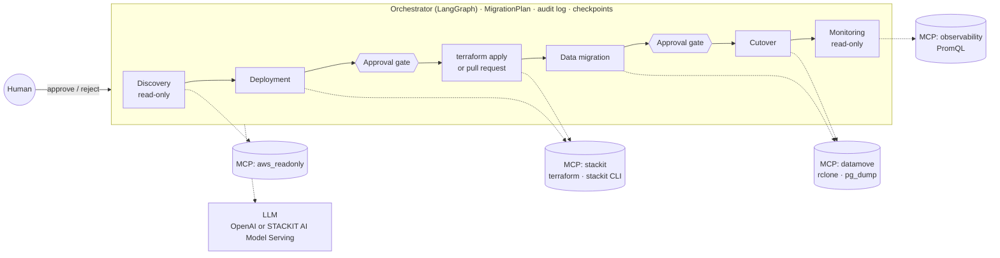

# STACKIT Migration Agents

A multi-agent accelerator that migrates workloads from **AWS** (Azure next) to
**STACKIT**, the sovereign German cloud of Schwarz Digits. Four agents,
orchestrated with LangGraph, take a workload from inventory to running on
STACKIT:

1. **Discovery** (read-only): inventories the AWS account, maps every resource
   to a STACKIT service, flags gaps and estimates costs.
2. **Deployment**: generates Terraform for the official `stackitcloud/stackit`
   provider, plans it, explains the plan in plain language and applies it, or
   opens a pull request, only after a human approved.
3. **Data migration**: copies S3 buckets (rclone) and PostgreSQL databases
   (pg_dump/pg_restore), verifies everything and cuts over after a second human
   approval. Source data is never deleted.
4. **Monitoring** (read-only): watches STACKIT Observability with PromQL rules
   and triages anomalies. It never remediates.

**The LLM decides and explains; deterministic code executes.** Terraform,
data copies and checks are generated by code and templates, never by an LLM.



Details: [docs/architecture.md](docs/architecture.md).

## 5-minute quickstart (mock mode)

Mock mode runs the whole flow with recorded data: no cloud account, no
credentials, no LLM key.

```bash
cd stackit-migration-agents
uv sync                                  # Python 3.12 + dependencies
uv run migrate run --source aws --mock   # full flow; answer y at the two gates
```

What you will see:

1. **Discovery** of a fictional shop in `eu-central-1` (36 resources): a
   mapping table, LLM-flagged risks (RDP open to the internet, a database with
   three consumers) and `discovery-report.md`.
2. **Deployment**: 39 STACKIT resources rendered to Terraform, the plan
   summarised by the LLM, and an approval prompt showing the raw plan.
3. **Data migration**: two buckets and a PostgreSQL database copied, 8 checks
   passed, `data-verification.md`, and a second approval for the cutover.
4. **Monitoring**: six rules evaluated, two anomalies triaged by the LLM with
   proposed fixes (not applied).

Everything lands in `runs/<run-id>/`:

| File | Content |
|---|---|
| `migration-plan.json` | The shared plan (all agents' results) |
| `audit.jsonl` | Every tool call, LLM decision and approval (secrets redacted) |
| `discovery-report.md` | Inventory, mapping, gaps, cost estimate |
| `terraform/` | Generated Terraform, `plan.txt`, README of review items |
| `data-verification.md`, `cutover-runbook.md` | Verification results, cutover steps |
| `monitoring-report.md` | Rules, anomalies, triage |

Step by step instead of all at once:

```bash
uv run migrate discover --source aws --mock     # prints the run id
uv run migrate plan     <run-id>
uv run migrate deploy   <run-id> --mode apply   # or --mode pr
uv run migrate approve  <run-id>                # or --reject --comment "why"
uv run migrate data     <run-id>
uv run migrate approve  <run-id>
uv run migrate monitor  <run-id> --interval 60 --iterations 3
uv run migrate status   <run-id>
```

`--yes` auto-approves the gates for unattended demos and is only accepted
with `--mock`. A walkthrough for presenting it: [demo/demo-script.md](demo/demo-script.md).

## Switching the LLM to STACKIT AI Model Serving

The LLM is configured only through environment variables (or `.env`); any
OpenAI-compatible endpoint works and switching needs **no code change**:

```bash
cp .env.example .env
# STACKIT AI Model Serving (OpenAI-compatible)
LLM_BASE_URL=https://api.openai-compat.model-serving.eu01.onstackit.cloud/v1
LLM_API_KEY=<model serving auth token>     # STACKIT portal or terraform: stackit_modelserving_token
LLM_MODEL=<model id from the STACKIT model catalogue>
```

Leave `LLM_BASE_URL` empty for OpenAI. Then try it on the mock clouds:

```bash
uv run migrate run --source aws --mock --live-llm
```

Notes:
- Pick a model that supports tool calling (used by the monitoring triage) and
  structured output. If JSON-schema output is not supported, keep
  `LLM_STRUCTURED_METHOD=function_calling` (default) or use `json_mode`.
- Known quirk handled: some open-weight models treat an empty `tools` list
  as "call a tool" and hallucinate a call. This project **never sends
  `tools=[]`** (`SafeChatOpenAI` strips empty tool parameters; tools are only
  bound when there are any).
- If an LLM answer is invalid, the agents fall back to the deterministic
  rule and mark the item for review; the run continues.

## Live runs

Prerequisites: `terraform` ≥ 1.5, the `stackit` CLI, `rclone`, PostgreSQL
client tools (`pg_dump`, `pg_restore`, `psql`), `gh` for PR mode.

1. **AWS, read-only:** create a user or role with
   [docs/aws-readonly-policy.json](docs/aws-readonly-policy.json) (describe/list
   only, no object reads) and set `AWS_PROFILE` or `AWS_*`.
2. **STACKIT:** a service account scoped to the single target project, see
   [docs/stackit-roles.md](docs/stackit-roles.md). Set `STACKIT_PROJECT_ID`,
   `STACKIT_SERVICE_ACCOUNT_KEY_PATH`, `STACKIT_IMAGE_ID`,
   `SSH_PUBLIC_KEY_PATH`.
3. Run:

   ```bash
   uv run migrate discover --source aws --region eu-central-1
   uv run migrate plan <run-id>                       # changes nothing
   uv run migrate deploy <run-id> --execute           # asks for approval, then applies
   uv run migrate approve <run-id>
   # export the target credentials from the sensitive terraform outputs:
   #   STACKIT_S3_ACCESS_KEY_ID / STACKIT_S3_SECRET_ACCESS_KEY,
   #   PG_DSN_SOURCE_<DB> / PG_DSN_TARGET_<DB>
   uv run migrate data <run-id> --execute             # copies, verifies, asks for cutover approval
   uv run migrate approve <run-id>
   uv run migrate monitor <run-id> --interval 60      # OBSERVABILITY_URL/USERNAME/PASSWORD
   ```

   **Dry run is the default.** Without `--execute`, deployment stops after
   `terraform plan` and data migration only runs `rclone copy --dry-run`.

**PR mode** (client-ready): `migrate deploy <run-id> --mode pr --execute`
pushes the Terraform to a branch of the client's infrastructure repository
(`PR_REPO`, `PR_REPO_PATH`) and opens a pull request with `gh`. The client's
pipeline applies it after review.

A small AWS source app for live demos (EC2, RDS PostgreSQL, S3) with a
teardown script is in [demo/aws-sample-app](demo/aws-sample-app).

## Safety model

- **Read-only source access:** AWS credentials are read-only, and every boto3
  client also rejects non-allowlisted operations in code before a request is
  sent. Object contents, user data and passwords are never read during
  discovery.
- **Human gates:** apply/PR and cutover need an approval via LangGraph
  `interrupt()`. The mutating MCP tools refuse to run without an HMAC token
  bound to the run, the action and the SHA-256 of the exact plan file or
  verification report that was approved.
- **Never delete source data:** transfers use `rclone copy` and `pg_dump`
  only (`sync`/`move`/`delete` are refused in code); decommissioning is out of
  scope.
- **No auto-remediation:** the monitoring agent and its LLM only have
  read-only query tools.
- **Secrets** come only from the environment or `.env` (git-ignored). They are
  passed to the MCP server that needs them and never appear in prompts, tool
  arguments, logs or the audit log (redaction plus libpq environment
  variables instead of command-line DSNs).
- **Audit trail:** every tool call, LLM decision and approval is in
  `audit.jsonl`; mutations are logged before and after execution.
- **Restart-safe:** runs are checkpointed (SQLite, or Postgres via
  `CHECKPOINT_BACKEND=postgres`); `migrate resume <run-id>` continues after a
  crash.

## Configuration

| File | Purpose |
|---|---|
| `.env` (from `.env.example`) | LLM, credentials, paths, webhook. Secrets only here. |
| `config/mapping.yaml` | Source → STACKIT mapping, sizing and gap rules (editable) |
| `config/pricing.yaml` | Prices for the cost estimate. **All placeholders: fill from the official price lists.** |
| `config/monitoring-rules.yaml` | PromQL rules and thresholds |

## Development

```bash
make install      # uv sync
make format lint  # ruff
make test         # pytest (TEST=tests/test_mapping.py make test)
make tf-check     # render mock Terraform, fmt -check, init, validate
make demo         # migrate run --source aws --mock
```

Tests cover the read-only guard, mapping, Terraform rendering (fmt and
validate), both approval gates, token checks, crash/resume, redaction, the
`tools=[]` guard, and integration with real rclone and PostgreSQL where
installed. CI: `.github/workflows/stackit-migration-agents.yml`.

```
src/migrate/            orchestrator, agents, state, LLM gateway, Terraform renderer, CLI
src/migrate/templates/  Terraform (*.tf.j2) and report templates
src/mcp_servers/        aws_readonly, azure_readonly, stackit, datamove, observability
config/                 mapping, pricing, monitoring rules
fixtures/               recorded data for mock mode
demo/                   AWS sample app, demo script
docs/                   architecture, IAM policy, STACKIT roles
```

## Known limitations

- Azure discovery is a stub with fixtures (same interface as AWS).
- MySQL has no managed equivalent on STACKIT; it maps to MariaDB with a review
  flag, and its data copy is manual in v1. Buckets with Glacier/Deep Archive
  objects are skipped until the objects are restored.
- PostgreSQL uses dump/restore (needs a write freeze); logical replication is a
  documented extension point.
- Items marked **TODO(verify)** (STACKIT machine-type sizes, per-service IAM
  roles, Observability query path and more) are listed in
  [docs/architecture.md](docs/architecture.md#verified-vs-to-verify).
