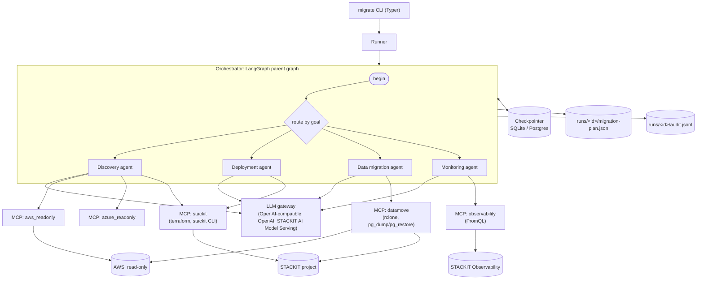
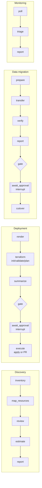
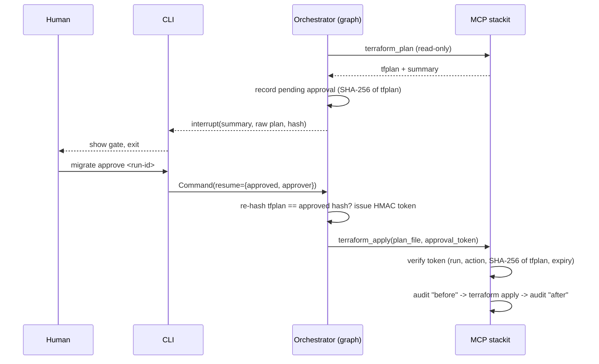

# Architecture

## Design principle

**The LLM decides and explains; deterministic code executes.**

| The LLM does | The LLM never does |
|---|---|
| Classifies workloads (role, criticality) and flags extra migration risks | Write Terraform, shell commands or SQL |
| Chooses between *listed* candidates when a mapping is ambiguous (validated; anything else falls back to the rule default and is flagged) | Invent target services, sizes or prices |
| Summarises the discovery, the Terraform plan and the data verification for the approver | Call a mutating tool (it is never given one) |
| Investigates monitoring anomalies with read-only PromQL queries and proposes a fix | Apply a fix (monitoring has no mutating tool at all) |

Terraform generation, data copying, verification and threshold evaluation are
plain Python, Jinja2 templates and CLI calls with argument lists.

## Components

- **Agents never call each other.** They read and extend the shared
  `MigrationPlan` (`src/migrate/state.py`), which travels through LangGraph
  state as JSON and is mirrored to `runs/<run-id>/migration-plan.json` after
  every node.
- **Tools are MCP servers** (FastMCP, stdio), started per agent step through
  `langchain-mcp-adapters` (`src/migrate/mcp_client.py`). Each server gets
  only the environment variables it needs: the AWS server never sees STACKIT
  credentials and vice versa.

## Orchestrator

Each CLI command invokes the parent graph on the LangGraph thread `run-id`
with a **goal**:

| Command | Goal | Stages that run (if not done yet) |
|---|---|---|
| `discover` | `discover` | discovery |
| `plan` | `plan` | discovery, deployment up to `terraform plan` |
| `deploy` | `deploy` | ... deployment up to the approval gate, then apply/PR |
| `data` | `data` | ... data migration up to the cutover gate, then cutover |
| `monitor` | `monitor` | one monitoring poll |
| `run` | `all` | everything, with both gates |

`begin` clears the previous halt reason; after every stage the router picks
the first unfinished stage of the goal, or ends. A stage **halts** the
invocation with a reason (dry run, rejection, failed verification): the CLI
prints it and the run can be continued later.

### Agent subgraphs

## Human gates and approval tokens

- The gate uses LangGraph `interrupt()`; the run waits in the checkpoint until
  `migrate approve` (or `--reject`) resumes it, from any process.
- A token is `v1.<claims>.<HMAC-SHA256>` with claims `run`, `act`
  (`terraform.apply`, `terraform.pr`, `data.cutover`), `sha` (artefact hash),
  `exp` (default 15 min) and a nonce. The HMAC secret is random per process
  unless `APPROVAL_SECRET` is set, and it is passed only to the mutating MCP
  servers through their environment, never through prompts or tool
  arguments.
- If the plan file or the verification report changes after approval, both the
  orchestrator and the MCP server refuse to act.
- **Dry run is the default.** Without `--execute`, deployment stops after the
  plan and data migration runs `rclone copy --dry-run` and no restore. Mock
  mode only simulates, so it walks through the gates without the flag.

## MCP tool servers

| Server | Tools | Mutating | Credentials (env of that server only) |
|---|---|---|---|
| `aws_readonly` | `get_account`, `list_compute_instances`, `list_block_volumes`, `list_networks`, `list_security_groups`, `list_databases`, `list_object_buckets`, `list_load_balancers`, `list_kubernetes_clusters` | no; the boto3 clients reject every operation not on the allowlist before a request is sent | `AWS_*` (read-only policy) |
| `azure_readonly` | same tools (stub with fixtures) | no | `AZURE_*` |
| `stackit` | `get_catalog`, `terraform_init`, `terraform_validate`, `terraform_plan`, **`terraform_apply`**, **`open_pull_request`** | apply / PR, token required | `STACKIT_*`, `TF_*`, `GH_*` |
| `datamove` | `bucket_stats`, `copy_bucket`, `sample_checksums`, `pg_transfer`, `pg_row_counts`, `pg_schema`, **`cutover`** | copy into the target; cutover requires a token; never deletes | `AWS_*`, `STACKIT_S3_*`, `PG_DSN_*` |
| `observability` | `query_promql`, `query_range` | no | `OBSERVABILITY_*` |

All server paths are confined to the run directory; identifiers that become
CLI arguments are validated; every command is an argument list (never a shell
string).

## Persistence and resume

- LangGraph checkpointer: SQLite (`runs/checkpoints.sqlite`) by default,
  Postgres with `CHECKPOINT_BACKEND=postgres`. The thread id is the run id.
- The plan is stored in graph state as JSON, so checkpoints never need to
  unpickle Python classes.
- Every command first resumes unfinished work (a crash mid-stage) before
  starting new work; `migrate resume <run-id>` does only that. Completed nodes
  are not repeated; a resumed `execute` re-issues its token from the recorded
  approval.
- If the checkpoint database is lost, the next command seeds a new thread
  from `migration-plan.json`.

## Audit log

`runs/<run-id>/audit.jsonl`, one JSON object per line:
`{ts, agent, action, status, phase?, inputs, result}`.

- Every MCP tool call, LLM call (`llm.decide`, `llm.write`,
  `llm.investigate`), approval request/decision, token issue and halt is
  recorded.
- Mutating actions are written **before and after** execution, by the agent
  and again by the MCP server itself.
- Redaction removes configured secret values, secret-looking keys
  (`password`, `token`, `dsn`, `webhook`...) and patterns (AWS access keys,
  bearer tokens, DSN passwords, private keys, Slack/Teams webhook URLs).
  Prompts are scrubbed the same way before they leave the process.

## Mock mode

`--mock` runs everything with recorded data and no credentials:

| Fixture | Content |
|---|---|
| `fixtures/aws/raw/recorded-responses.json` | Raw AWS API responses for a fictional 3-tier shop |
| `fixtures/aws/inventory.json` | The same responses replayed through the **real** `AwsAdapter` (botocore Stubber), see `migrate.tools.build_aws_fixture` |
| `fixtures/stackit/catalog.json` | Illustrative STACKIT catalogue (names from the docs, sizes not verified) |
| `fixtures/datamove/mock-results.json` | Transfer statistics, row counts, schemas |
| `fixtures/metrics/metrics.json` | PromQL results after the cutover |
| `fixtures/llm/*.json` | Recorded LLM answers per task and key |

Terraform is really rendered in mock mode; only `init`/`plan`/`apply` are
simulated (the plan output is generated from the rendered files). CI renders
the mock Terraform and runs `terraform fmt -check` and `terraform validate`
with the real provider.

`--live-llm` keeps the clouds mocked but calls the configured LLM.

## Terraform generation

`src/migrate/terraform.py` builds a model from the plan and renders
`src/migrate/templates/terraform/*.tf.j2`:

- one `stackit_network` per subnet (the VPC itself has no 1:1 resource);
  security groups only if attached to migrated servers or referenced by them;
  servers with NICs (`security = true`), boot volume from `var.image_id`;
  data volumes plus `stackit_server_volume_attach`;
- PostgreSQL Flex with the flavor looked up by CPU/RAM/node type through
  `data.stackit_postgresflex_flavors` and a `precondition`; ACLs built from
  the egress IPs of the networks whose servers the source security groups
  allowed to reach the database (plus SKE egress ranges if the cluster's
  nodes were clients);
- MariaDB for MySQL (flagged), Object Storage buckets plus one credentials
  group/credential for the copy, ALB (with a new TLS certificate) or NLB, SKE;
- `# REVIEW:` comments and a generated README list what needs a human look and
  what was **not** rendered (gaps).

Only GA resources are used (no beta data sources, no experiments). Output is
`terraform fmt` clean and validated against provider v0.119.0.

## Extension points

- **Azure:** implement `SourceCloudAdapter` in `adapters/azure.py` (the MCP
  server and everything downstream stay unchanged).
- **PostgreSQL logical replication:** `LogicalReplication` in
  `mcp_servers/datamove/postgres.py` (strategy name `logical_replication`).
- **MySQL → MariaDB data copy:** currently a skipped task with instructions.
- **More resource types:** add a kind to `config/mapping.yaml`, a sizing branch
  in `mapping.py` and a template.

## Verified vs. to verify

Verified against the STACKIT provider docs and source (v0.119.0), the CLI docs
and `terraform validate`: all resource types and arguments used, role names,
CLI commands, Object Storage endpoint and region.

Marked **TODO(verify)** in code and config (no access to docs.stackit.cloud
during development): STACKIT machine-type sizes and per-service role names,
JSON key names of some CLI outputs, availability zones other than `eu01-1` for
servers, the PromQL query path of STACKIT Observability, volume performance
class names, the SKE cluster name length limit, and static-website support on
Object Storage. All prices are placeholders.
